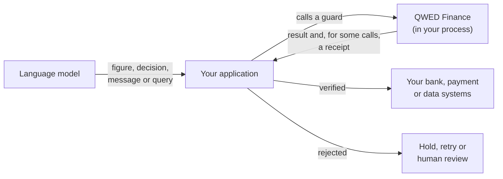
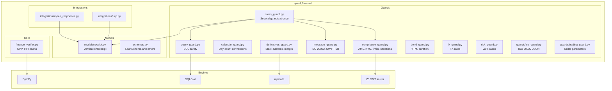
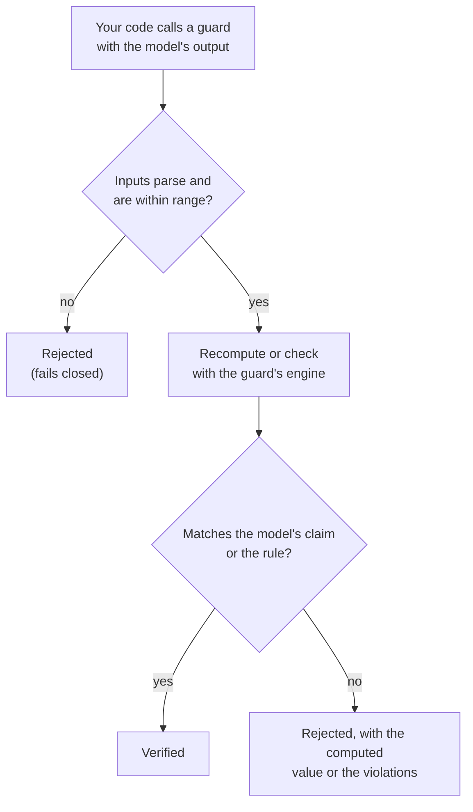
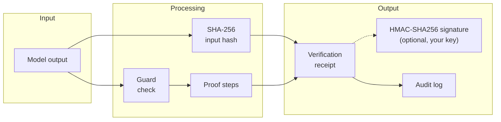
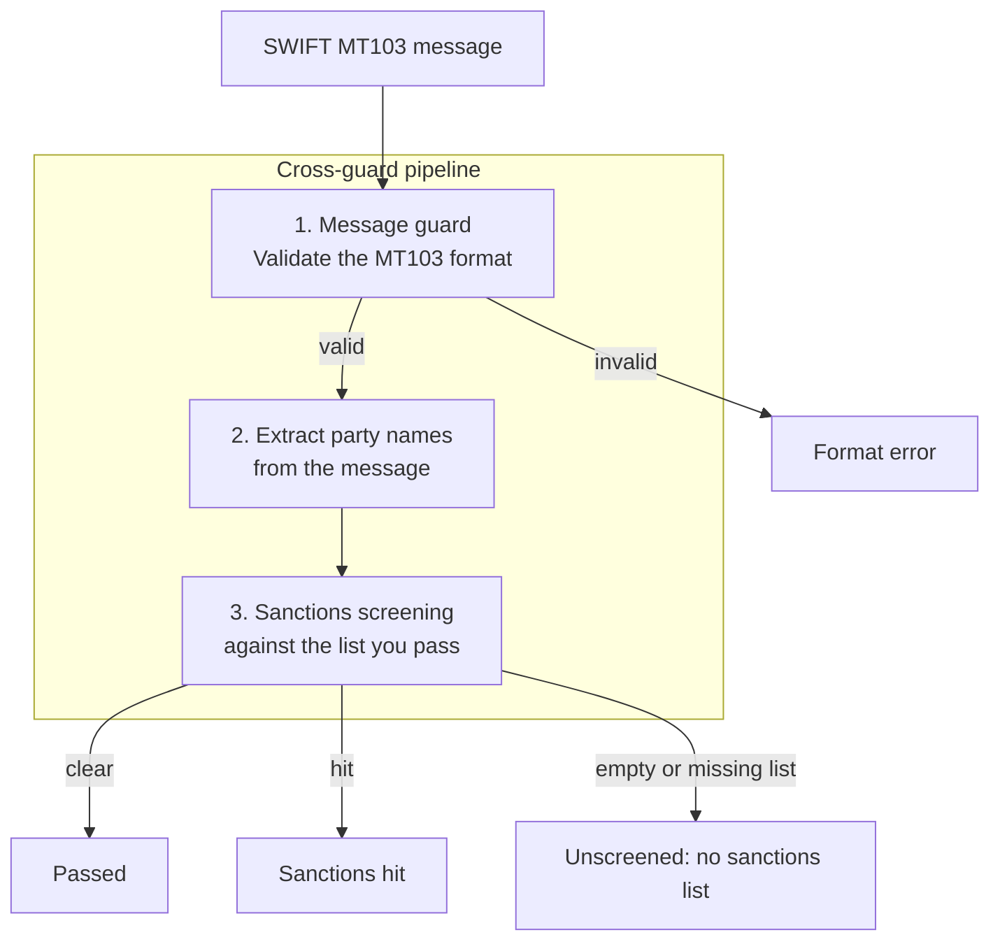
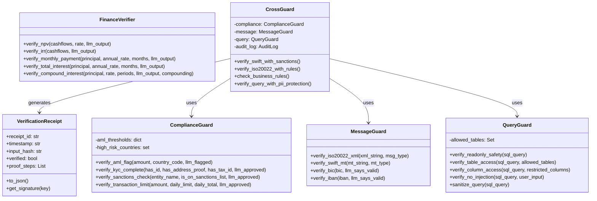

This page describes how QWED Finance is organised inside.

## Where it runs

QWED Finance is a library. It runs inside your process and makes no network calls. Your code calls a guard with the model's output, and decides what to do with the result: act on it, hold it, or send it to a person.

## Guard architecture

### Component diagram

## Verification flow

Every check follows the same path. Input that cannot be parsed, or that is ambiguous, fails closed: it is rejected, never passed through as if it were correct.

`CrossGuard`, `UCPIntegration` and the built-in `OpenResponsesIntegration` tools also issue receipts. `UCPIntegration` can return `PENDING_REVIEW` when an amount needs an AML flag.

## Data flow

### Verification receipt

Receipts are unsigned until you call `get_signature(key)`. See [Compliance and auditing](/finance/compliance).

### Cross-guard pipeline: SWIFT with sanctions

`CrossGuard.verify_swift_with_sanctions()` runs three steps.

An empty or missing sanctions list fails closed as unscreened. A name the screening cannot assess is sent to review, never cleared.

## Class diagram

## Deployment

- **Python:** install `qwed-finance` and call the guards from your service.
- **Node.js:** `@qwed-ai/finance` runs the Python package in a child process and passes JSON over stdin; install `qwed-finance` on the same machine. See the [Quickstart](/quickstart).
- **Receipts and audit logs:** `AuditLog` keeps receipts in memory. Export them with `export_json()` and store them where you keep your other audit records, with the signatures stored separately.

---

## Design principles

### 1. Determinism first

The same input gives the same verdict. No sampling, no confidence scores.

### 2. Exact over approximate

Use solvers and exact arithmetic (Z3, SymPy, mpmath, `Decimal`) instead of floating point or probabilistic scores. Where a numeric method is the only option, as in the IRR fallback, the result says so.

### 3. Audit where it matters

`CrossGuard`, `UCPIntegration` and the built-in `OpenResponsesIntegration` tools generate receipts automatically. Direct guard calls and custom Open Responses tools return result objects; create a receipt with `ReceiptGenerator` when you need an audit record.

### 4. Fail closed

Input that is malformed, ambiguous or missing is rejected, never treated as passing.

---

## Related pages

- [Overview](/finance/overview): what QWED Finance checks
- [The 11 guards](/finance/guards): each guard with examples
- [Compliance and auditing](/finance/compliance): receipts and audit logs
