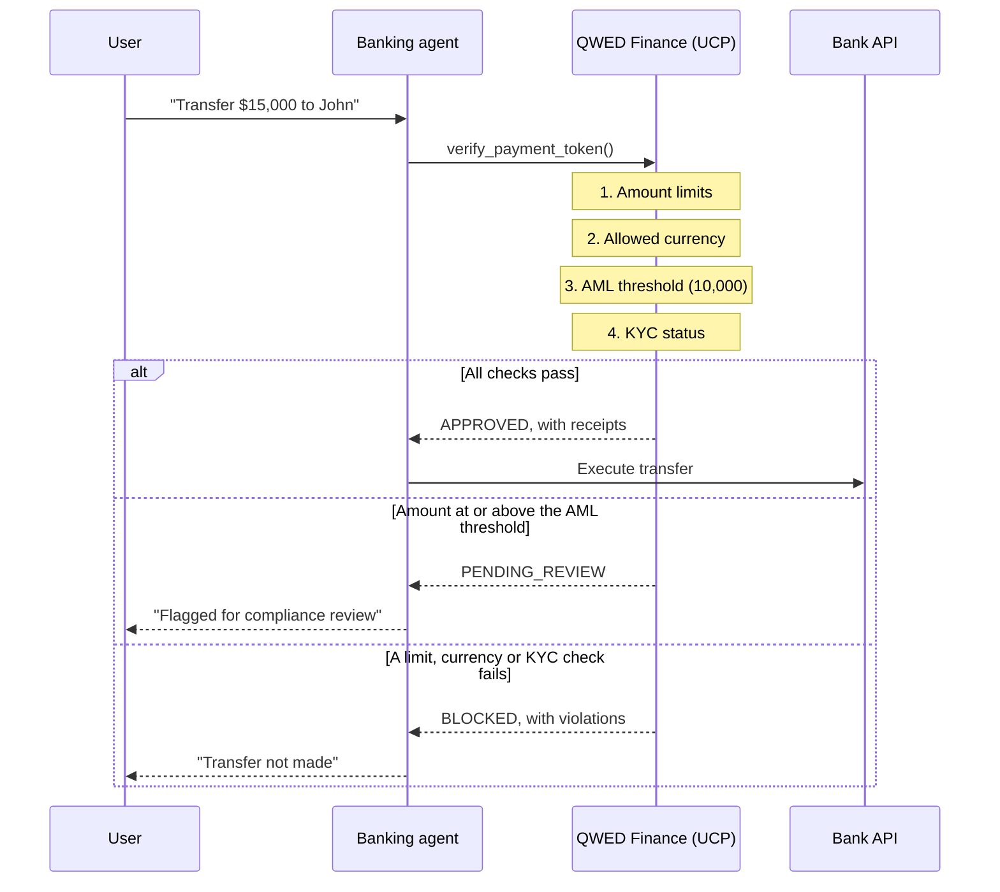

**Deterministic verification for financial AI (v3.0.1).**

QWED Finance is a verification library for financial AI. A language model proposes a figure, a decision, a payment message or a query; QWED Finance recomputes or checks it with deterministic code before your system acts on it. It does not make the model more accurate. It decides whether a given output may be used.

It combines exact and formal tools: SymPy for cash-flow maths, Z3 for the AML rule, mpmath and `Decimal` for pricing and risk, XML parsing with required-element rules for ISO 20022 and SWIFT, and the SQLGlot parser for SQL safety.

**New in v3.0.1: security fixes.**

- ISO 20022 business rules read amounts and currencies from the parsed XML tree, not from raw text ([GHSA-mrrj-6m2q-jch9](https://github.com/QWED-AI/qwed-finance/security/advisories/GHSA-mrrj-6m2q-jch9))
- Sanctions screening folds diacritics and look-alike letters and compares separator-free names, so `E.V.I.L. CORP` or `ÉVIL CORP` no longer clears an `EVIL CORP` entry ([GHSA-mv2c-jwm9-pfrq](https://github.com/QWED-AI/qwed-finance/security/advisories/GHSA-mv2c-jwm9-pfrq))
- `QueryGuard` rejects MySQL `/*! ... */` and MariaDB `/*M! ... */` executable comments ([GHSA-q8r4-6gpp-5fx2](https://github.com/QWED-AI/qwed-finance/security/advisories/GHSA-q8r4-6gpp-5fx2))

**v3.0.0 highlights:** keyed HMAC receipt signatures (`get_signature(key)`), ISO amount and currency limits in receipts and UCP, a fail-closed batch for AML, sanctions, amounts and message validation, and a breaking change to the npm bridge (stdin JSON with runtime validation). See the [changelog](https://github.com/QWED-AI/qwed-finance/blob/main/CHANGELOG.md) for details.

## Why QWED Finance?

Language models get arithmetic and strict rules wrong, and in finance close enough is not good enough.

- **Problem:** a model says "IRR is 12%" when it is 11.8%.
- **What QWED Finance does:** it recomputes the IRR from the cash flows and rejects the claim when it differs by more than the tolerance. It reports the value it computed; it does not rewrite the model's answer.

<Note>
`verify_irr` solves NPV = 0 with SymPy and uses the first real root above -100%. Cash flows that change sign more than once can have several IRRs, and the first root is not always the one you mean: check those with `verify_npv` at each candidate rate. When SymPy finds no real root, the method falls back to a numeric solver and reports `verification_mode="HEURISTIC"` instead of `"SYMBOLIC"`.
</Note>

## Key features

- **11 guards:** Compliance, Calendar, Derivatives, Message, ISO, Query, Cross, Bond, FX, Risk and Trading.
- **GitHub Action:** checks financial calculations in CI, with optional SARIF output for security dashboards.
- **Receipts:** verification receipts for cross-guard and integration flows. Receipts are unsigned by default: call `get_signature(key)` and store the HMAC-SHA256 signature separately to get a tamper-evident record.
- **Deterministic results:** each check is computed by code, so the same input gives the same result.

## The four parts of banking verification

| Part | Guards | Engine | Use case |
|--------|-------|--------|----------|
| **Calculation** | Finance, Calendar, Derivatives, Bond, FX, Risk | SymPy, `Decimal`, mpmath | NPV, IRR, day counts, option prices, YTM, VaR |
| **Rules** | Compliance | Z3 for AML flags; rule checks for KYC, limits and sanctions decisions | AML flags, KYC completeness, transaction limits, sanctions decisions |
| **Messages** | Message, ISO | XML parsing and required-element rules, JSON Schema | ISO 20022, SWIFT MT |
| **Data safety** | Query | SQLGlot | Read-only queries, table and column allow-lists, injection patterns |

## Quick example

```python
from qwed_finance import ComplianceGuard

guard = ComplianceGuard()

# Check an AML flagging decision
result = guard.verify_aml_flag(
    amount=15000,        # at or above the 10,000 threshold
    country_code="US",
    llm_flagged=True     # the model flagged it
)

print(result.compliant)  # True
print(result.proof)      # "Z3: LLM decision matches regulatory requirement"
```

## Architecture

### Where QWED Finance sits

Your code chooses the guard for each output. QWED Finance returns a result; your system decides what to do with it.

```mermaid
flowchart TB
    subgraph Agent["Your AI agent or pipeline"]
        LLM["Language model"]
    end

    subgraph QWED["QWED Finance v3.0.1"]
        direction TB
        Guards["Guard chosen by your code<br/>(Compliance, Bond, Query, ...)"]
        Receipt["Verification receipt<br/>(CrossGuard, UCP, Open Responses)"]
    end

    subgraph Yours["Your system"]
        Act["Act on the output"]
        Hold["Hold, reject or ask a person"]
    end

    LLM -->|"figure, decision, message or query"| Guards
    Guards -->|"verified"| Act
    Guards -->|"rejected or unparseable"| Hold
    Guards -.-> Receipt
```



### Guards and their engines

| Guard | Engine |
| --- | --- |
| `FinanceVerifier` (NPV, IRR, loans, compound interest) | SymPy, `Decimal` |
| `ComplianceGuard` | Z3 (AML flags) and rule checks (KYC, limits, sanctions decisions) |
| `CalendarGuard` | `Decimal` day-count arithmetic |
| `DerivativesGuard` | mpmath (30 decimal places) |
| `BondGuard`, `FXGuard`, `RiskGuard`, `TradingGuard` | `Decimal` |
| `MessageGuard` | defusedxml parsing and required-element rules |
| `ISOGuard` | JSON Schema |
| `QueryGuard` | SQLGlot |
| `CrossGuard` | combines Message, Compliance and Query, and issues receipts |

### Payment check with UCP

`UCPIntegration.verify_payment_token()` runs four checks: amount limits, currency, AML threshold and KYC status. Sanctions screening is part of `verify_iso20022_payment()`, which takes a sanctions list.



## Why not just trust the model?

Language models are probabilistic. They can:

- state a figure that is wrong
- miss a compliance threshold, such as the 10,000 currency transaction report limit
- produce a payment message that is missing required elements
- write SQL that changes or deletes data

QWED Finance checks each of these with deterministic code:

| Model output | What QWED Finance does | Engine |
|------------|-------------------|--------|
| "NPV is $180.42" | recomputes the NPV | SymPy |
| "Transaction is compliant" | checks the threshold rule | Z3 |
| "Payment XML is valid" | parses it and checks required elements | XML rules |
| "SELECT * FROM users" | parses the query and checks tables and columns | SQLGlot |

## Rules and standards the checks are built around

The checks implement parts of these rules and standards. Using QWED Finance does not make a system compliant with them: that is for your own compliance review.

- **BSA/FinCEN**: the 10,000 currency transaction report threshold in `verify_aml_flag`
- **OFAC and other sanctions lists**: name screening against a list you supply
- **ISO 20022 and SWIFT MT**: message structure and business-rule checks
- **RBI FREE-AI (India)**: receipts and audit logs as records of how an AI output was checked

## FinanceVerifier: fail-closed inputs

`FinanceVerifier` rejects ambiguous or unknown inputs instead of silently falling back to a default. In finance, a wrong answer with no error signal is worse than a loud failure.

### `verify_compound_interest`: accepted compounding frequencies

<Warning>
**Since v2.1.0:** `verify_compound_interest()` raises `ValueError` for unknown compounding frequencies. Earlier releases silently used **annual** compounding for unknown values (for example `"weekly"` or `"continuous"`), producing wrong results with no sign of failure.
</Warning>

Accepted values for the `compounding` argument:

| Value | Periods per year |
| --- | --- |
| `annual` | 1 |
| `semi-annual` | 2 |
| `quarterly` | 4 |
| `monthly` | 12 |
| `daily` | 365 |

```python
from qwed_finance import FinanceVerifier

verifier = FinanceVerifier()

# Supported frequency
result = verifier.verify_compound_interest(
    principal=10000,
    rate=0.05,
    periods=10,
    compounding="monthly",
    llm_output="$16,470.09",
)

# Unknown frequency: fails closed
verifier.verify_compound_interest(
    principal=10000,
    rate=0.05,
    periods=10,
    compounding="weekly",  # not supported
    llm_output="$16,470.09",
)
# raises ValueError:
#   Unknown compounding frequency: 'weekly'.
#   Accepted values: annual, daily, monthly, quarterly, semi-annual
```

If you need a frequency outside this list, compute the equivalent rate yourself and pass one of the supported values.

## Next steps

- [The 11 guards](/finance/guards): each guard with working examples
- [Compliance and auditing](/finance/compliance): receipts and audit logs
- [QWED UCP: transaction verification for AI commerce](https://docs.qwedai.com/ucp/overview): connect finance checks to commerce transactions
- [QWED Open Responses: verified tool calls for AI agents](https://docs.qwedai.com/open-responses/overview): check finance-related agent actions before they run
